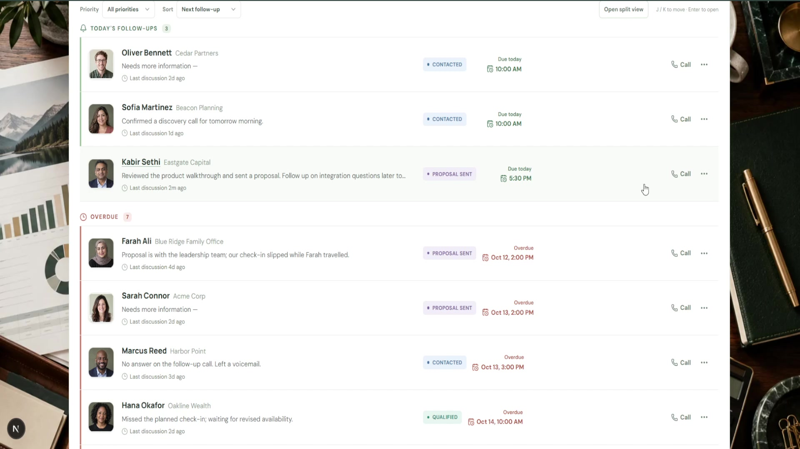
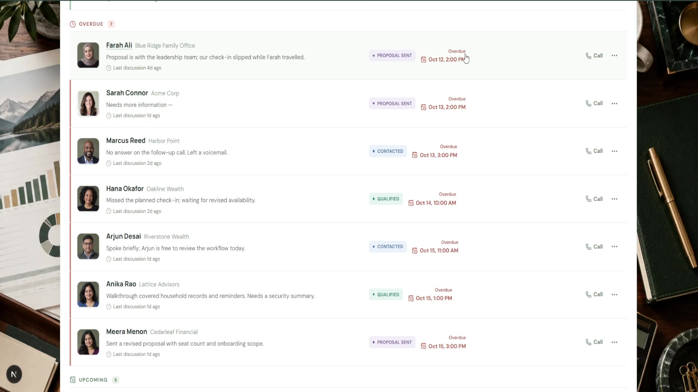
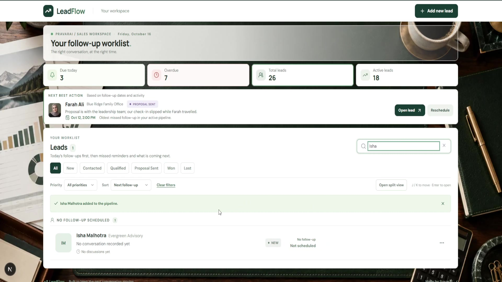
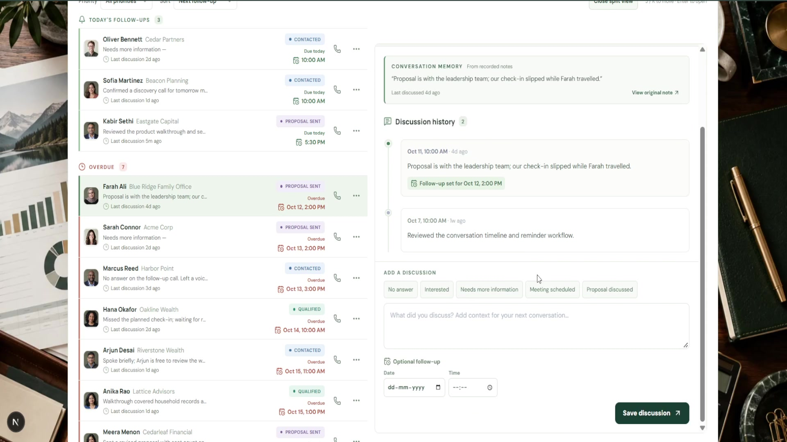

# LeadFlow

**Pick up every conversation where you left it.**

It's the start of the day. One prospect is waiting for pricing, another asked for a call this afternoon, and someone you spoke to last week still needs an answer. Before the next call, you need to remember what was said—and what you promised to do next.

LeadFlow puts that context on one screen. See who needs a follow-up, open their conversation history, write down the outcome, and set the next reminder. The worklist updates as soon as you save.

Built for the **PravarAI fullstack assessment**: a lightweight CRM for tracking leads, discussions, and follow-ups.

[Watch the 2:58 walkthrough](https://github.com/BlackBeanEagles/pravar-leadflow/releases/download/leadflow-demo-2026-10-16/LeadFlow-demo.mp4) · [Video and subtitles](https://github.com/BlackBeanEagles/pravar-leadflow/releases/tag/leadflow-demo-2026-10-16) · [Run locally](#local-setup)


## A day with LeadFlow

### Start with the people who need an answer

Today's follow-ups sit at the top of the worklist. Older missed reminders appear in red below them, followed by upcoming reminders and leads without a scheduled follow-up. Won and Lost leads stay in a separate Closed group.

Each row gives you the contact's name, company, status, latest note, and time since the last discussion. Search for a person or narrow the list by status and follow-up priority before making the next call.

### Remember the last conversation

Click a lead to open a dialog without leaving the worklist. Contact details and status sit alongside the full discussion history, newest first. The Conversation Memory excerpt quotes the latest stored note and links back to it. An optional desktop split view keeps the list and lead detail open together.


### Leave a clear next step

After the call, add a discussion and an optional follow-up date and time. The note and reminder appear in the list immediately. Change the status from the same dialog, or reschedule a reminder independently. Everything is saved in SQLite, ready for the next visit.

### Make room for the next relationship

Add a lead with just a name. Company and phone are optional, and the status starts as **New**. The next conversation can begin without filling out a long contact form.

## Assessment coverage

- **Core flows:** lead list, all six status filters, today's pinned follow-ups, timeline dialog, discussion creation, follow-up scheduling, and persistent status updates.
- **All listed bonuses:** name search, red overdue reminders, Docker Compose, a seed script with 25 leads and 39 discussions, and filters.
- **Submission material:** public repository, `.env.example`, setup instructions, screenshots, and a recorded walkthrough with generated male narration, labels, and subtitles.

## A few useful details

- **A starting point for the day:** Next Best Action selects the oldest missed follow-up, then today's earliest reminder, then the next upcoming reminder, then an active lead without a reminder. It follows explicit date-based rules.
- **Less searching:** search by name, company, or phone; filter by priority; and sort within groups by next follow-up, latest discussion, or recently added.
- **Fewer steps after a call:** editable note starters, phone links, and row menus for logging a discussion, rescheduling, and changing status.
- **Keyboard access:** `/` focuses search, `N` opens Add Lead, and `J` / `K` move through leads while the worklist is focused. Enter opens a focused row; Escape closes a dialog.
- **Responsive details:** scrollable lead dialogs, focus kept inside open dialogs, mobile layouts, loading and empty states, error messages, and save confirmations.

## Stack

Next.js 16 (React 19, TypeScript), Next.js Route Handlers, built-in Node.js SQLite, and CSS. Node.js 24 is required for `node:sqlite`. This single-service setup keeps local startup simple while providing persistent server-side storage and REST-style endpoints.

- `components/` contains the worklist, lead rows, dialogs, discussion form, and login UI.
- `lib/lead-priority.ts` holds grouping, sorting, and next-action rules; `lib/db.ts` owns the database schema and queries.
- `app/api/` contains the lead, discussion, and authentication endpoints, with shared parsing in `lib/api.ts`.
- `scripts/seed.mjs` creates the demo data; `tests/` checks seed behavior and lead priorities.

## Local setup

1. Install **Node.js 24** and npm.
2. Clone the repository and enter its directory:

   ```bash
   git clone https://github.com/BlackBeanEagles/pravar-leadflow.git
   cd pravar-leadflow
   ```

   Copy `.env.example` to `.env.local` if you want to change the database location or enable login. The default works without an env file.
3. Run:

   ```bash
   npm ci
   npm run seed
   npm run dev
   ```

4. Open [http://localhost:3000](http://localhost:3000). If that port is occupied, use the address printed in the terminal.

For a production run, use `npm run build` followed by `npm start` after installing dependencies and seeding the database.

The seed script adds 25 fictional leads and 39 discussions to an empty database. It also expands the original seven-lead demo database without changing those existing records. Re-running it does not create duplicates, and it skips databases that do not contain the original demo records. To reset demo data, stop the app, remove `data/leadflow.sqlite` (plus any `-wal` and `-shm` files), then run `npm run seed` again.

### Optional login

Set `AUTH_USERNAME`, `AUTH_PASSWORD`, and a long random `AUTH_SECRET` in `.env.local` (or Docker Compose environment) to enable login. When enabled, the app redirects unauthenticated visitors to `/login`, protects every lead API route, and uses a signed, HTTP-only, seven-day cookie. Leave all three unset for a frictionless local assessment demo. Use HTTPS in any non-local deployment.

## Docker Compose

With Docker Desktop running:

```bash
docker compose up --build -d
docker compose logs -f
```

Open [http://localhost:3000](http://localhost:3000). Port 3000 must be free. The named volume preserves the database between restarts; the container seeds an empty database automatically.

Use `docker compose down` to stop the app while retaining the database volume. For Docker login, put the three `AUTH_*` variables in a root `.env` file; Compose forwards them to the container.

## API

- `GET /api/leads` — list leads with their latest discussion summary.
- `POST /api/leads` — create a lead; requires `name`, with optional `company` and `phone`.
- `GET /api/leads/:id` — fetch lead details and newest-first discussions.
- `PATCH /api/leads/:id` — update either `status` or `followUpAt`; use `null` to clear a reminder.
- `POST /api/leads/:id/discussions` — add `note` and optional `followUpAt`.
- `POST /api/auth` — sign in when optional login is configured.
- `DELETE /api/auth` — sign out.

The API uses 201 for successful creation, 400 for malformed JSON/IDs, 401 for unauthorized access when login is enabled, 404 for missing leads, 422 for invalid fields, and 500 for unexpected storage errors.

## Verification

```bash
npm run build
npm test
```

The five automated tests cover follow-up grouping, ordering, next-action selection, seed idempotency, and expansion of the original demo without overwriting its records.

The screenshots below were captured from the current workspace on October 16, 2026. The demo contacts are fictional; relative times and follow-up groups change with the local date.

[Watch the narrated walkthrough (2 min 58 sec)](https://github.com/BlackBeanEagles/pravar-leadflow/releases/download/leadflow-demo-2026-10-16/LeadFlow-demo.mp4). The video includes on-screen labels and subtitles. A separate `.srt` file is attached to the same release.

## More screenshots

<details>
<summary>Explore follow-ups, lead creation, split view, and login</summary>











</details>

## Design decisions

- Follow-up dates are stored as ISO timestamps and classified in the user's local time zone.
- Today's section includes every follow-up scheduled for the local calendar day. A time missed earlier today stays pinned there and is highlighted red; older missed reminders appear under Overdue. Won and Lost remain under Closed.
- Adding a note without a follow-up retains the existing scheduled follow-up. Adding one with a date replaces it.
- The current data model has discussion notes and follow-up dates but no interaction-type field. Quick note starters are saved as plain text, and Conversation Memory only quotes actual notes.
- The workspace photograph and portraits for the 25 fictional seed contacts are served as WebP assets to keep the page light. Leads added by a user display initials.
- Login is optional to enable locally. It is a single shared workspace with one configured credential; add real user accounts and account scoping before deploying for customers.

## Scope and AI assistance

LeadFlow is a single shared workspace with an optional configured login. Separate user accounts, account-level data access, and email or push notifications would be further work. Follow-up reminders are displayed inside the app.

AI was used to help draft the implementation and documentation and to create the financial-planning desk background and demo contact portraits. The walkthrough uses generated male narration with captions timed to that audio. The requirements were interpreted from the supplied brief, and the app was built, reviewed, and tested through its production build and working browser/API flows. The sample data and portraits are fictional.
