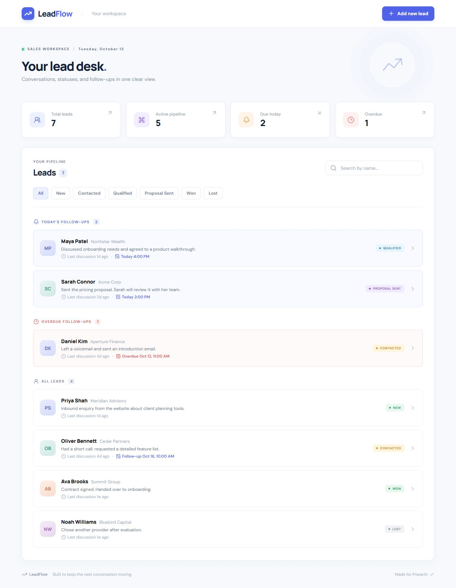
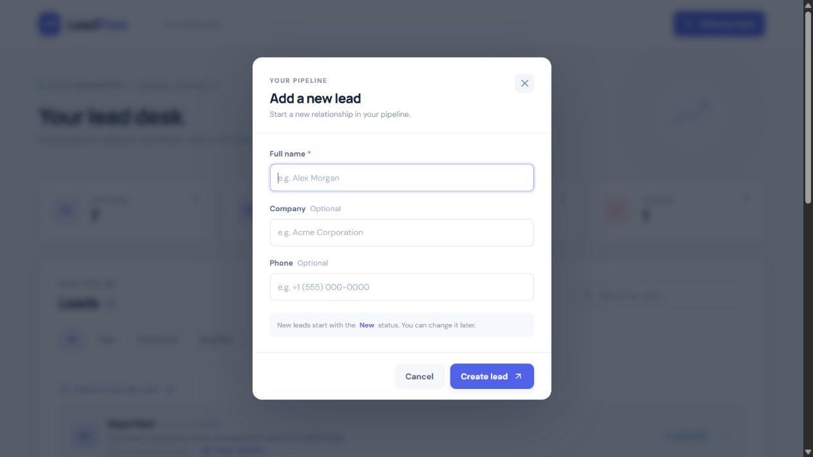
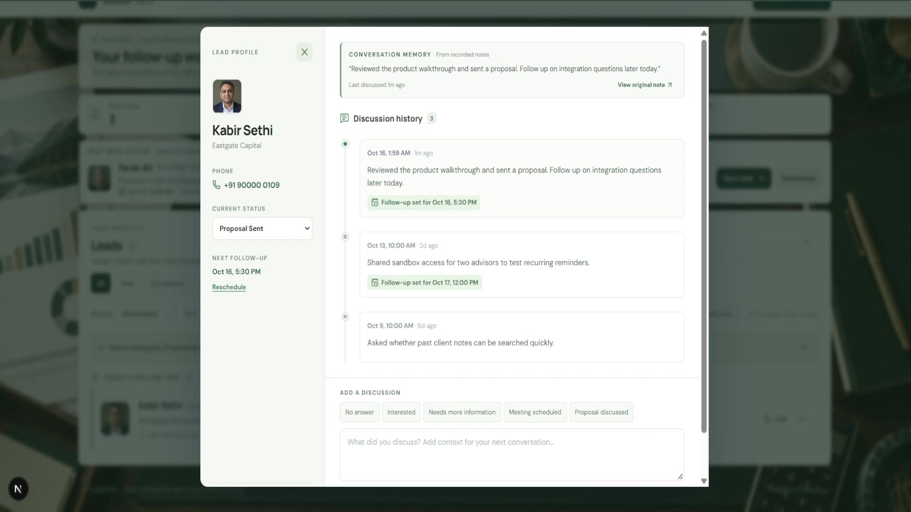
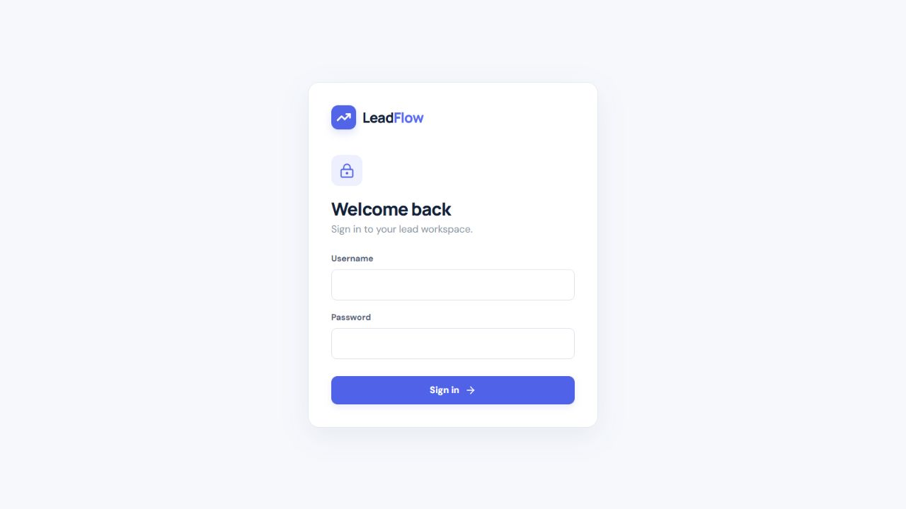

# LeadFlow

A single-screen lead management tool for the PravarAI fullstack assessment. A sales rep can track leads, read discussion history, log notes, change statuses, and schedule follow-ups without leaving the page.

## What it does

- Lead cards show name, company, status, last note, time since the last discussion, and any follow-up.
- Today's follow-ups appear before the rest of the pipeline. Overdue follow-ups are highlighted in red.
- Search by name and filter by all six statuses.
- A lead opens a timeline dialog with discussions in newest-first order, a status selector, and a note form with an optional follow-up date and time.
- Saving a note or changing status refreshes the list immediately and persists in SQLite.
- Add a lead with a required name and optional company and phone. New is the default status.
- Responsive layout, keyboard-closeable dialogs, empty states, and API validation/errors.
- Optional password login, enabled through environment variables.

## Stack

Next.js 16 (React 19, TypeScript), Next.js Route Handlers, built-in Node.js SQLite, and CSS. Node.js 24 is required for `node:sqlite`. This single-service setup keeps local startup simple while providing persistent server-side storage and REST-style endpoints.

## Local setup

1. Install **Node.js 24** and npm.
2. Copy `.env.example` to `.env.local` if you want to change the database location. The default works without an env file.
3. Run:

   ```bash
   npm ci
   npm run seed
   npm run dev
   ```

4. Open [http://localhost:3000](http://localhost:3000).

The seed script is idempotent: it adds seven example leads and discussions only when the database is empty. To reset demo data, stop the app, remove `data/leadflow.sqlite` (plus any `-wal` and `-shm` files), then run `npm run seed` again.

### Optional login

Set `AUTH_USERNAME`, `AUTH_PASSWORD`, and a long random `AUTH_SECRET` in `.env.local` (or Docker Compose environment) to enable login. When enabled, the app redirects unauthenticated visitors to `/login`, protects every lead API route, and uses a signed, HTTP-only, seven-day cookie. Leave all three unset for a frictionless local assessment demo. Use HTTPS in any non-local deployment.

## Docker Compose

With Docker installed, run `docker compose up --build` and open [http://localhost:3000](http://localhost:3000). The named volume preserves the database between restarts; the container seeds an empty database automatically.

## API

| Method | Route | Purpose |
| --- | --- | --- |
| GET | `/api/leads` | List leads with latest discussion summary |
| POST | `/api/leads` | Create a lead; requires `name` |
| GET | `/api/leads/:id` | Lead details and newest-first discussions |
| PATCH | `/api/leads/:id` | Update `{ "status": "Qualified" }` |
| POST | `/api/leads/:id/discussions` | Add `{ "note": "...", "followUpAt": "ISO date" }` |
| POST | `/api/auth` | Sign in when optional login is configured |
| DELETE | `/api/auth` | Sign out |

The API uses 201 for successful creation, 400 for malformed JSON/IDs, 401 for unauthorized access when login is enabled, 404 for missing leads, 422 for invalid fields, and 500 for unexpected storage errors.

## Verification

```bash
npm run build
npm test
```

The `public/screenshots` directory contains captures of the working list, add lead dialog, and discussion timeline.

## Screenshots









## Design decisions

- Follow-up dates are stored as ISO timestamps and classified in the user's local time zone. A follow-up earlier today stays pinned under Today and is marked overdue.
- Adding a note without a follow-up retains the existing scheduled follow-up. Adding one with a date replaces it.
- Login is optional to enable locally. It is a single shared workspace with one configured credential; add real user accounts and account scoping before deploying for customers.

## AI assistance

AI was used to help draft the implementation and documentation. The requirements were interpreted from the supplied brief, and the app was built, reviewed, and tested through its production build and working browser/API flows. The sample data is fictional.
